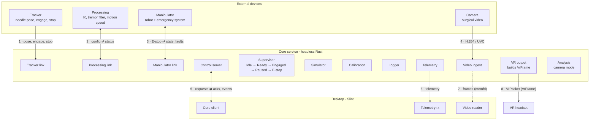

# Core service data map

Snapshot of the whiteboard: https://claude.ai/artifact/63oVAYJcxERLT3pBpSZNbc

## System diagram

Numbers on the arrows match the link numbers in the tables below.

Inside the core, every subsystem reports to the **Supervisor** over channels. The Supervisor is the only one that changes state.

| Subsystem | In | Out |
|---|---|---|
| Tracker link | UDP packets from tracker | Pose, engage/stop events |
| Processing link | Filtered pose, JointCmd copy, status | Config, safety state, calibration transform |
| Manipulator link | RobotState, faults, heartbeat | E-stop, calibration commands |
| Video ingest | Camera stream | Frames to memfd ring, frame IDs |
| Supervisor | Commands, heartbeats, faults | Safety state, snapshots |
| Simulator | JointCmd on the sim port | RobotState, same as the real robot |
| Calibration | Robot poses, camera frames | Transform to processing and VR |
| Logger | Copy of every link | MCAP files, replay stream |
| VR output | State, poses, sim, calibration, analysis | VrPacket, VrCalib |
| Control server | Requests from desktop | Ack / Nack, events |
| Telemetry | Supervisor snapshots | Telemetry to desktop |
| Analysis | Video frames | AnalysisResult to VR output |

## Messages per link

| Link | Transport | Core sends | Core receives |
|---|---|---|---|
| 1 · Tracker | UDP | — | Pose {seq, t_us, x, y, z, roll, pitch}, engage / disengage, stop |
| 2 · Processing | UDP | SetScaling, SetMode, SafetyState, calibration transform, heartbeat | Filtered pose (t), JointCmd copy, status, heartbeat |
| 2 · Processing (sim) | UDP, sim port | STATE packets from SimRobot | JointCmd |
| 3 · Manipulator | UDP / UART | E-stop, calibration commands, heartbeat | End-effector pose (t + Δt), joint state, faults, heartbeat |
| 4 · Camera | RTP / UVC | — | H.264 stream or raw frames |
| 5 · Desktop control | Unix seqpacket | Ack / Nack {id}, events, memfd handle (once) | Request {id, Command}: SetMode, LoadScenario, SimControl, SetScaling, Calibration, Logging, SoftEStop, ResetEStop, VrOutput, heartbeat |
| 6 · Desktop telemetry | Unix dgram | Telemetry {seq, t_us, mode, safety, ee_pose, joints, scaling, latency, packets_lost} | — |
| 7 · Desktop video | memfd ring | Frames {frame_id, t_us, w, h, format} | — |
| 8 · VR headset | UDP | VrPacket {header, VrFrame} each tick · VrCalib when calibration changes | — |

Notes:
- The tracker also sends pose straight to the processing system. The core only gets a copy, for logging and the engage/stop inputs.
- Joint commands go directly from processing to the manipulator. In sim mode they go to the core's Simulator on a separate port instead.

## Data types

Packed little-endian unless marked postcard. Every UDP / UART packet starts with `PktHeader`; UART packets are also COBS-framed.

| Type | msg_type | Link | Fields | Size |
|---|---|---|---|---|
| PktHeader | — | All UDP / UART | magic u16 (0xA55A), version u8, msg_type u8, seq u32, t_us u64, len u16 | 18 B |
| Pose | 0x01 | 1 | header, x y z f32, roll pitch f32, flags u8, crc16 u16 | 41 B |
| EngageEvent | 0x02 | 1 | header, state u8 (engage / disengage / stop), crc16 u16 | 21 B |
| JointCmd | 0x10 | 2, sim port | header, joints [f32; 6], flags u8 (engaged, clutch), crc16 u16 | 45 B |
| FilteredPose | 0x11 | 2 | header, pose [f32; 7] (x y z + quaternion), crc16 u16 | 48 B |
| ProcConfig | 0x12 | 2 | header, scaling f32, mode u8, safety u8, crc16 u16 | 26 B |
| CalibTransform | 0x13 | 2 | header, transform [f32; 16] (4×4, row-major), crc16 u16 | 84 B |
| RobotState | 0x20 | 3, sim port | header, ee_pose [f32; 7], joints [f32; 6], fault_bits u32, crc16 u16 | 76 B |
| EStop | 0x30 | 2, 3 | header, source u8, reason u8, crc16 u16 | 22 B |
| Heartbeat | 0x31 | 2, 3 | header, node_id u8, status u8, crc16 u16 | 22 B |
| Request | postcard | 5 | id u32, cmd Command | variable |
| Command | postcard | 5 | Hello { client_version u16 } · Heartbeat · SetMode(Mode) · LoadScenario { path String } · SimControl(SimAction) · SetScaling { ratio f32 } · Calibration(CalibAction) · Logging(LogAction) · SoftEStop · ResetEStop · VrOutput { enabled bool, addr SocketAddr } | variable |
| Reply | postcard | 5 | Ack { id u32 } · Nack { id u32, reason String } | variable |
| Event | postcard | 5 | ModeChanged(Mode) · SafetyChanged(SafetyState) · CalibResult { error_mm f32 } · Warning(String) | variable |
| Telemetry | postcard | 6 | seq u32, t_us u64, mode Mode, safety SafetyState, ee_pose [f32; 7], joints [f32; 6], scaling f32, link_latency_us u32, packets_lost u32 | ≤ 78 B |
| FrameHeader | — | 7 | frame_id u64, t_us u64, width u32, height u32, stride u32, format u32 (fourcc), then pixel data | 32 B + pixels |
| VrPacket | 0x40 | 8 | header, payload = VrFrame (postcard) | ≤ 1400 B |
| VrCalib | 0x41 | 8 | header, calib_id u32, transform [f32; 16], crc16 u16 | 88 B |
| VrFrame | postcard | inside 0x40 | seq u32, t_us u64, mode Mode, safety SafetyState, ee_pose [f32; 7], joints [f32; 6], input_pose [f32; 7], cmd_pose [f32; 7], scaling f32, latency_us u32, calib_id u32, video_frame_id Option<u64>, sim Option<SimScene>, analysis Option<AnalysisResult> | ~150 B + sim + analysis |
| SimScene | postcard | in VrFrame | objects Vec<SceneObject>, contacts Vec<Contact>, score SimScore | variable |
| SceneObject | postcard | in SimScene | id u16, kind ObjectKind, pose [f32; 7] | ~31 B |
| Contact | postcard | in SimScene | a u16, b u16 (object ids), point [f32; 3], force_n f32 | ~20 B |
| SimScore | postcard | in SimScene | target_error_mm f32, elapsed_s f32, path_mm f32, tremor_rms_mm f32 | 16 B |
| AnalysisResult | postcard | in VrFrame | frame_id u64, tool_tip_px [f32; 2], tool_tip_3d Option<[f32; 3]>, dist_to_target_mm f32, tremor_hz f32, warnings u8 | ~35 B |

## Enums and message codes

| Enum | Values | Encoding |
|---|---|---|
| Mode | Sim · Live · Replay | u8 |
| SafetyState | Idle · Ready · Engaged · Paused · EStopped | u8 |
| SimAction | Start · Pause · Reset · Step | postcard |
| CalibAction | Begin · Capture · Compute · Accept · Cancel | postcard |
| LogAction | Start { name String } · Stop · Replay { file String, speed f32 } | postcard |
| EStop source | Desktop · Tracker stop · Manipulator · Watchdog | u8 |
| ObjectKind | Needle · Tissue · Target · Tool | u8 |
| msg_type | 0x01–0x0F tracker · 0x10–0x1F processing · 0x20–0x2F robot · 0x30–0x3F safety · 0x40–0x4F VR | u8 |

## What enters the VR payload (VrFrame)

| VrFrame field | From | Mode | Why VR needs it |
|---|---|---|---|
| mode, safety | Supervisor | Both | Status, E-stop warning |
| ee_pose, joints | Manipulator link (live) / Simulator (sim) | Both | Draw the robot where it really is |
| input_pose | Tracker link | Both | Where the surgeon's hand is |
| cmd_pose | Processing link | Both | Commanded vs actual pose |
| scaling, latency_us | Supervisor, device links | Both | Shown to the surgeon |
| calib_id (+ VrCalib) | Calibration | Both, on change | Everything in one coordinate frame |
| sim.objects, sim.contacts | Simulator | Sim | Draw the simulated scene |
| sim.score | Simulator | Sim | Training feedback |
| video_frame_id | Video ingest | Camera | Match overlays to the video frame |
| analysis | Analysis | Camera | Tool tip, distance, tremor overlays |
| (video pixels) | Video ingest | Camera | Not in VrFrame: sent on its own stream |
